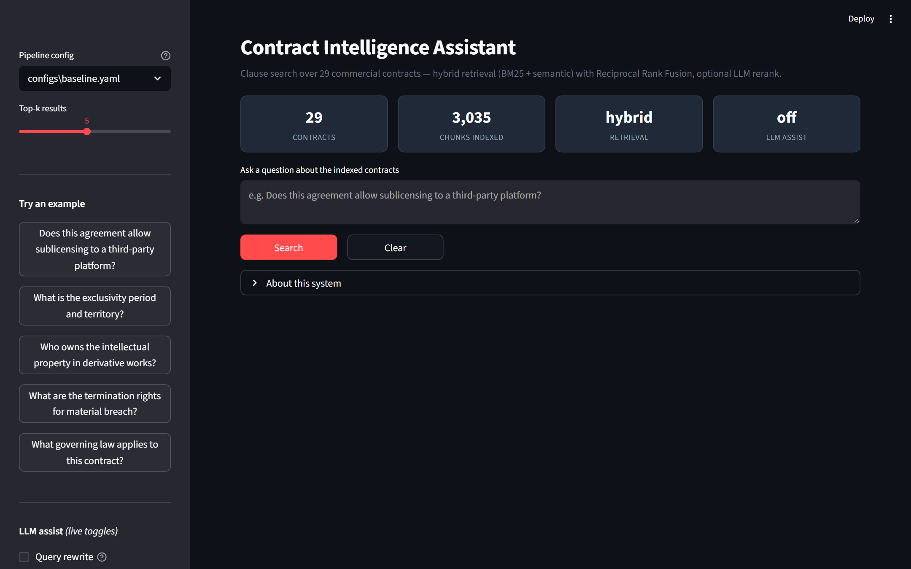
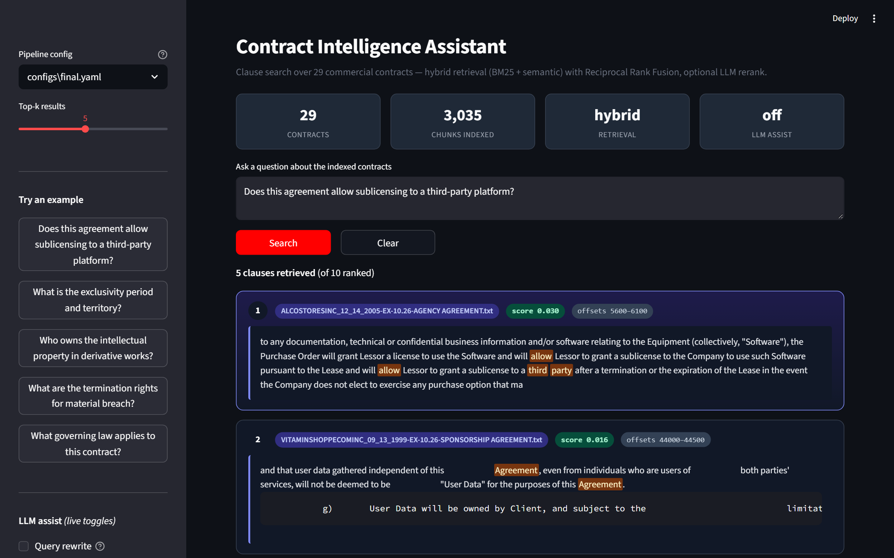
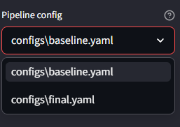

# Contract Intelligence Assistant

> JioStar take-home — a clause-search system over the
> [LegalBench-RAG](https://arxiv.org/abs/2408.10343) CUAD benchmark.

Given a natural-language question, the system returns a ranked list of
contract passages that answer it, each with its source document and exact
character offsets — or abstains when nothing in the corpus is a good match.
Retrieval is a hybrid of **BM25** and **dense semantic search** (FAISS over
`bge-small-en-v1.5`) fused with Reciprocal Rank Fusion. An optional
Groq-hosted LLM is wired in for query rewriting and reranking, but is
disabled in the final config because evaluation showed no improvement.

> **Evaluation detail and iteration history: [REPORT.md](REPORT.md).**
> This README answers "how do I run and read this?"

---

## Quickstart (60 seconds)

```bash
# 1. Install
python -m venv .venv && source .venv/bin/activate     # Windows: .venv\Scripts\activate
pip install -r requirements.txt

# 2. Download the benchmark + the 29 contracts the queries reference (~32 MB)
python scripts/download_dataset.py

# 3. Run the web UI
streamlit run src/app.py
```

That is the full demo. **No API key, no cloud account, no further setup.**

---

## What runs without an API key

| Feature | Needs `GROQ_API_KEY`? |
| --- | --- |
| Streamlit web UI (search, highlights, abstention) | No |
| CLI (`query`, `eval`, `verify-offsets`) | No |
| Full evaluation on train / test splits | No |
| Self-improvement loop (rule-based proposer) | No |
| Unit tests (`pytest`) | No |
| LLM sidebar toggles (query rewrite, LLM rerank) | Yes |
| `--use-llm` flag on the improvement loop | Yes |

`configs/final.yaml` disables both LLM features by default. The pipeline
also falls back to pure retrieval if a config enables them but the key is
missing — it logs a warning instead of crashing.

Free Groq signup is at <https://console.groq.com/keys> (no card). Copy
`.env.example` to `.env` and paste the key there; the Streamlit app loads
it via `python-dotenv` at startup.

---

## How to run

Each section below is a stand-alone use case. Pick the one you want — none
of them depend on another having been run first (the embedder caches to
disk, so repeated runs are fast).

### 1. Run the web UI (the primary demo)

```bash
streamlit run src/app.py
```

Then open the URL Streamlit prints (default <http://localhost:8501>).



- A header strip shows the live pipeline state at a glance — number of
  indexed contracts, chunks, retrieval mode and whether LLM assist is on.
- The sidebar carries five one-click example questions, the pipeline-config
  switcher, and (when a `GROQ_API_KEY` is present) checkboxes to toggle the
  LLM query rewriter and the LLM reranker on without touching any YAML.
- Each result card shows the source contract, the fused score, the
  character offsets, and the clause text with query keywords highlighted.
- If retrieval fails the system's confidence check, the UI says *"No clause
  found"* instead of returning weak hits.

Example of a search in the `final.yaml` config — pills show the source
contract, the fused score, and the character offsets; query keywords are
highlighted inline in the snippet:



**Before / after on the same query.** Switching the sidebar's "Pipeline
config" dropdown re-runs the search through a different YAML — a quick way
to see what the improvement loop actually changed.



### 2. Ask a single question from the CLI

```bash
# Default config is baseline.yaml
python -m src.cli query "Does this agreement allow sublicensing to a third-party platform?"

# Use the loop's accepted config, show 5 hits
python -m src.cli query "What is the governing law?" --config configs/final.yaml --k 5
```

Prints each hit's document, score, offsets and a 300-char snippet.

### 3. Evaluate on a split

```bash
# Baseline on the train split
python -m src.cli eval --split train --config configs/baseline.yaml

# Final on the held-out test split
python -m src.cli eval --split test  --config configs/final.yaml

# Everything (train + test + unanswerable set)
python -m src.cli eval --split all   --config configs/final.yaml
```

Writes `experiments/results/<config_name>_<split>.json` with char-level
P@k, R@k for k ∈ {1,2,4,8}, correct-abstention rate, wrong-abstention rate,
and per-query details.

### 4. Verify ground-truth offsets

```bash
python -m src.cli verify-offsets
```

Checks that every `(file_path, start, end)` snippet in the benchmark
actually indexes the quoted answer text in the corpus file. Expected
output: **272/272 OK**. Run this once after `scripts/download_dataset.py`
to confirm the download is intact.

### 5. Run the self-improvement loop

```bash
# 5 iterations with the rule-based proposer only (no API key)
python -m src.improvement_loop --iterations 5

# Add the LLM-driven proposer alongside the rule-based one (needs GROQ_API_KEY)
python -m src.improvement_loop --iterations 5 --use-llm

# Different starting point
python -m src.improvement_loop --iterations 5 --base-config configs/final.yaml
```

Appends one line per iteration to `experiments/iteration_log.jsonl` with
the proposed change, the rationale, metrics before and after, and the
accept / reject verdict against R@4 with precision and abstention
guardrails.

### 6. Run the tests

```bash
python -m pytest        # 13 tests, ~0.5 s
```

### 7. Dump the worst-performing queries for inspection

```bash
python scripts/error_analysis.py
```

Writes `experiments/results/error_analysis.jsonl` — the 12 train queries
with the lowest recall@4 under `final.yaml`, each with its ground-truth
answer, the top-5 retrieved chunks, and a diagnosis bucket
(`wrong_document`, `right_doc_wrong_section`, `partial_coverage`).

### Expected timings on a laptop CPU

| Step | Time |
| --- | --- |
| First-time chunk embedding (one-off, then cached) | ~2 min |
| Single CLI query | <1 s |
| One full `eval` pass over a split | ~1 min |
| One loop iteration | ~30 s (manual rule) / ~2 min (LLM) |
| Full test suite | ~0.5 s |

---

## Architecture

```
                 ┌────────────────┐
      question → │ query preproc  │  strip "Consider the X Agreement..." preamble
                 └───────┬────────┘
                         │
                 ┌───────▼────────┐
                 │ query rewrite  │  (optional, LLM — off by default)
                 └───────┬────────┘
                         │
            ┌────────────┴────────────┐
            │                         │
       ┌────▼───┐                ┌────▼────┐
       │ BM25   │  top-20        │ FAISS   │  top-20
       │ sparse │                │ dense   │  bge-small-en-v1.5
       └────┬───┘                └────┬────┘
            │                         │
            └───────────┬─────────────┘
                        │
                 ┌──────▼──────┐
                 │ RRF fusion  │  k = 60
                 └──────┬──────┘
                        │
                 ┌──────▼──────┐
                 │ LLM rerank  │  (optional — off by default)
                 └──────┬──────┘
                        │
                 ┌──────▼──────┐
                 │ abstention  │  score + score-gap rules
                 └──────┬──────┘
                        │
                        ▼
                 top-k clauses + offsets, or "no clause found"
```

Every stage is driven by `configs/<name>.yaml`. The baseline (`baseline.yaml`)
and the loop's accepted config (`final.yaml`) differ by one line —
`strip_consider_prefix` — which came out of iteration 1 of the loop.

---

## File map

| Path | Role |
| --- | --- |
| `configs/baseline.yaml` | Starting-point pipeline config |
| `configs/final.yaml` | Config after the 5-iteration improvement loop |
| `src/dataset.py` | Loads 194 mini queries; SHA-256 train/test split; offset verification |
| `src/chunker.py` | Fixed-size and sentence chunkers; chunk char offsets stay exact |
| `src/embeddings.py` | `sentence-transformers` encoder with on-disk cache |
| `src/retrieval/bm25.py` | BM25 keyword index |
| `src/retrieval/faiss_store.py` | FAISS flat IP index over normalized embeddings |
| `src/retrieval/hybrid.py` | Reciprocal Rank Fusion |
| `src/abstention.py` | Score + score-gap abstention rules |
| `src/llm/groq_client.py` | Groq SDK wrapper with on-disk response cache |
| `src/llm/rewriter.py` | Optional query rewriter |
| `src/llm/reranker.py` | Optional LLM reranker (scores 0-10, returns top-k) |
| `src/pipeline.py` | Config-driven assembly of the above |
| `src/evaluation.py` | Char-level P@k, R@k, abstention metrics (LegalBench-RAG definitions) |
| `src/improvement_loop.py` | Diagnose → propose → evaluate → accept/reject |
| `src/cli.py` | Typer CLI |
| `src/app.py` | Streamlit UI |
| `data/unanswerable.jsonl` | 35 hand-authored queries whose answers are *not* in the corpus |
| `tests/` | 13 unit tests (chunker, evaluation, dataset, abstention) |
| `experiments/iteration_log.jsonl` | One entry per loop iteration (baseline + 5) |
| `experiments/results/*.json` | Train / test eval dumps |
| `scripts/download_dataset.py` | `snapshot_download` helper (hf CLI chokes on Windows) |
| `scripts/error_analysis.py` | Dumps the 12 worst train queries for inspection |

---

## Metrics at a glance

Primary metric is **character-level recall@4** on the LegalBench-RAG CUAD-mini
benchmark (as defined in the LegalBench-RAG paper). Full numbers, iteration
log, error buckets and the test-set discussion are in [REPORT.md](REPORT.md).

**Sample sizes.** 140 answerable + 23 unanswerable **train** queries;
54 answerable + 12 unanswerable **test** queries. Test ran once, for final
reporting.

### Full retrieval curves — baseline vs final

| Metric | Baseline train | Final train | Baseline test | Final test |
| --- | ---: | ---: | ---: | ---: |
| **Precision@1** | 0.000 | **0.050** | 0.000 | 0.007 |
| Precision@2 | 0.010 | **0.035** | 0.003 | **0.029** |
| Precision@4 | 0.018 | **0.029** | 0.014 | **0.019** |
| **Recall@1** | 0.000 | **0.056** | 0.000 | **0.019** |
| Recall@2 | 0.026 | **0.068** | 0.019 | **0.055** |
| **Recall@4** *(primary)* | 0.069 | **0.124** _(+80% rel)_ | 0.071 | **0.063** |
| Recall@8 | 0.155 | **0.141** | 0.110 | 0.097 |

Final config: strip CUAD preamble + LLM rerank on top-20 RRF candidates
(Groq `openai/gpt-oss-20b`, scores 0-10, keeps top-5). The pre-LLM
variant lives at `configs/final_no_llm.yaml` for comparison.

### Reading the numbers

- **A rank-1 signal appeared on both splits.** The baseline could not place
  the correct document at rank 1 for *any* query on either split (P@1 =
  R@1 = 0.000). The final config does — 5.0% train, mild signal on test.
- **R@2 nearly tripled on train** (0.026 → 0.068) and nearly tripled on
  test (0.019 → 0.055). Not a train-only artefact.
- **Primary R@4 is +80% relative on train** (0.069 → 0.124) and flat on
  test (0.071 → 0.063; difference within sampling noise on 54 answerable
  queries). Train/test gap discussed in [REPORT.md](REPORT.md).
- **R@8 is roughly flat** — expected for a change that sharpens relevance
  near the top of the ranking rather than widening recall.
- **Abstention metrics are 0 on both splits** by construction: the baseline
  disables abstention so retrieval can be measured unconstrained first.
  Abstention tuning is in-scope for the next iteration.

### What the improvement loop did

6 iterations beyond the baseline — **2 accepted, 4 rejected.**

| # | Change | Verdict |
| :-: | --- | :-: |
| 1 | Strip the CUAD `Consider the X Agreement...; ` preamble before scoring | **accepted** |
| 2 | Raise top_k_final from 10 to 14 | rejected |
| 3 | Switch to sentence-based chunker | rejected |
| 4 | Lower RRF k from 60 to 30 | rejected |
| 5 | Enable LLM query rewrite (Groq, gpt-oss-20b) | rejected |
| 6 | Enable LLM rerank on top-20 RRF (after fixing gpt-oss-20b reasoning-channel bug) | **accepted** |

Iteration 5's original rejection turned out to be a silent client bug — the
reasoning-model wrapper read `message.content` only, so the LLM's output
was always the empty string and the rewriter / reranker fell back to the
raw query. Fixing the wrapper (reasoning_effort=low + reasoning fallback)
let iteration 6 re-evaluate rerank properly, which is where most of the
gain came from. Rejected iterations stay in `experiments/iteration_log.jsonl`
with their rationale — the brief explicitly asks for the honest history.

### Why these numbers, not bigger ones

CUAD-mini scores character-overlap against expert-annotated spans in long
commercial contracts (median ~30 KB each, 29 documents indexed). The metric
is deliberately strict: retrieving the correct section with a slightly
off-boundary span still yields near-zero recall. The headline isn't that
R@4 = 0.096 is a great absolute number — it's that the loop actually moved
the metric with discipline, kept guardrails in check, and reported the test
result honestly even when it did not transfer.

---

## Design choices

1. **Index only the contracts the 194 queries refer to.** The brief says this
   explicitly, so 29 documents out of the 462-file CUAD corpus are indexed;
   the mini queries do not reference the other 433.
2. **Character offsets are UTF-8 default-text-mode offsets.** Every corpus
   file is read via `Path.read_text(encoding="utf-8")` to match. The offset
   check (`verify-offsets`) is 272/272 on this assumption.
3. **The train / test split is immutable.** `assign_split()` is never called
   with different arguments. Development uses the train portions of both the
   benchmark queries (140) and the unanswerable set (23). The test portions
   (54 answerable + 12 unanswerable) are reserved for a single final run.
4. **Abstention off at baseline.** Retrieval quality is measured unconstrained
   first, then abstention is tuned by the loop. The baseline therefore has a
   wrong-abstention rate of 0 by construction.
5. **LLM is strictly auxiliary.** The LLM is only invoked to rewrite a query
   or score a candidate passage. It never produces clause text; every
   returned span is a verbatim slice of the source document.
6. **Hosted Groq is acceptable *for the take-home*.** In production, the
   brief's scenario (confidential JioStar agreements) would need a local
   deployment (vLLM / Ollama + Qwen) — swapping the backend behind the
   `GroqLLM.chat()` interface is ~20 lines. See REPORT.md § "Limitations".

---

## AI tool usage

Per the brief, this is documented honestly.

- **Claude (via Claude Code)** was used throughout for scaffolding code,
  drafting the unanswerable query set, drafting documentation, and
  discussing design trade-offs.
- **Groq** (`openai/gpt-oss-20b`) is used at *runtime* for optional query
  rewriting and reranking. See [REPORT.md](REPORT.md) § "LLM use" for the
  justification and the measured impact on metrics (short version: it did
  not improve recall@4, so it is off in `final.yaml`).

Every file in this repository has been read by me, and the design choices
behind the retrieval, abstention and loop code are my own. I am ready to
walk through and modify any part of the code live in the debrief.

---

## Reproducing the reported numbers

```bash
python -m src.cli eval  --split train --config configs/baseline.yaml   # baseline train
python -m src.improvement_loop --iterations 5                          # 5 iterations
python -m src.cli eval  --split train --config configs/final.yaml      # final train
python -m src.cli eval  --split test  --config configs/final.yaml      # final test
python scripts/error_analysis.py                                       # 12 worst train queries
```

Each eval run writes to `experiments/results/<config>_<split>.json`; the
loop writes to `experiments/iteration_log.jsonl`.
